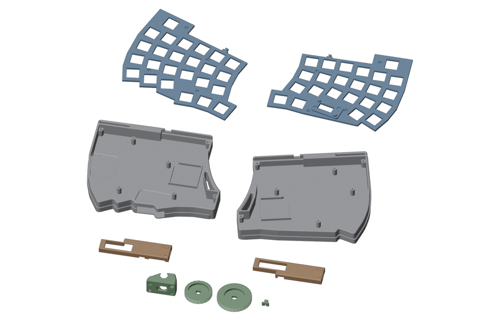
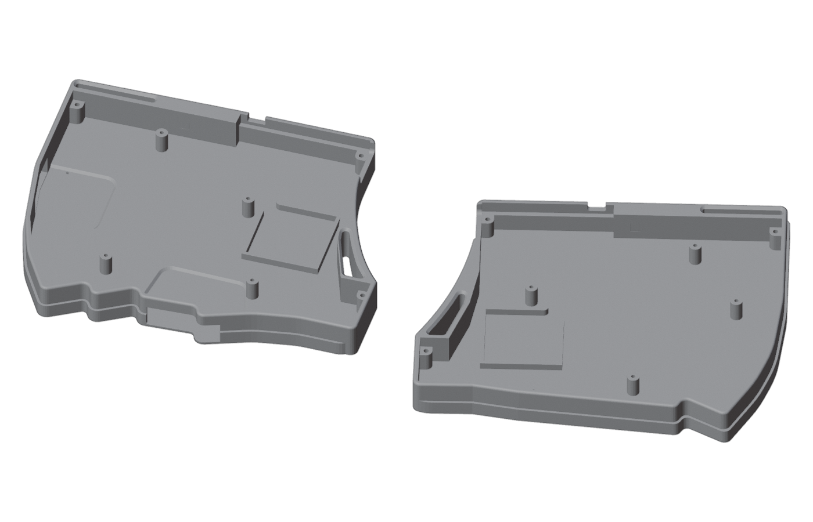
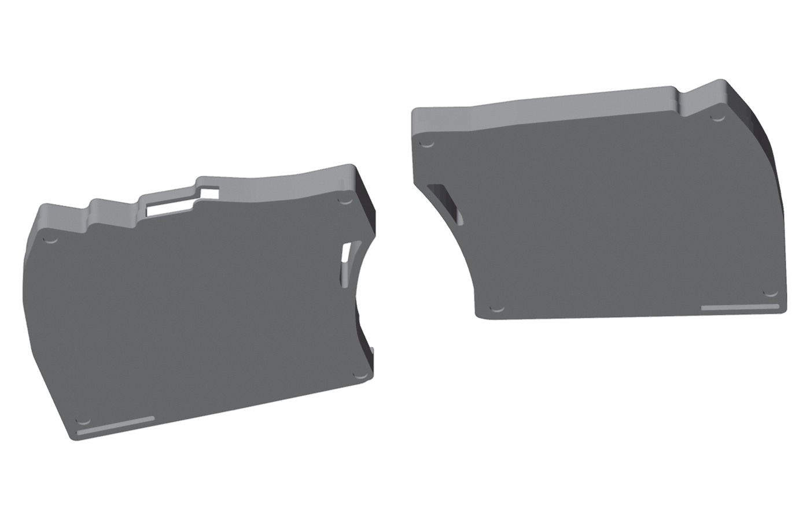

# LoTom ケースデータ

LoTom のケース・スイッチプレート・小物パーツの 3D データです。
LoTom は基板のみの販売です。ケースやプレートなどはこのデータを使って各自で 3D プリント (または外注) してください。

| ケース (上から) | ケース (底面) |
|---|---|
|  |  |

## ファイル

- 印刷用: `stl/`
- CAD 用: `step/`

| パーツ | STL | STEP | サイズ (mm) | 備考 |
|---|---|---|---|---|
| ケース 左 | `stl/lotom_case_L.stl` | `step/lotom_case_L.step` | 151.9 × 123.5 × 15.0 | 上下一体のケース |
| ケース 右 | `stl/lotom_case_R.stl` | `step/lotom_case_R.step` | 140.7 × 142.6 × 15.0 | 上下一体のケース |
| ケース 左右 | – | `step/lotom_case_LR.step` | 316.3 × 142.6 × 15.0 | 左右を並べたもの (閲覧用) |
| スイッチプレート 左 | `stl/lotom_plate_L.stl` | `step/lotom_plate_L.step` | 132.8 × 143.3 × 6.2 | |
| スイッチプレート 右 | `stl/lotom_plate_R.stl` | `step/lotom_plate_R.step` | 142.3 × 110.9 × 6.0 | 1.6mm 厚の基板用 |
| トップカバー 左 | `stl/lotom_cover_L.stl` | `step/lotom_cover_L.step` | 77.1 × 20.0 × 6.0 | マイコン部のカバー |
| トップカバー 右 | `stl/lotom_cover_R.stl` | `step/lotom_cover_R.step` | 77.1 × 20.0 × 6.0 | マイコン部のカバー |
| トラックボールホルダー | `stl/lotom_trackball_holder.stl` | `step/lotom_trackball_holder.step` | 31.9 × 16.5 × 18.0 | 19mm ボール用 |
| サイドホイール | `stl/lotom_wheel_side.stl` | `step/lotom_wheel_side.step` | 30.0 × 30.0 × 5.0 | 左手サイドのスライドロータリー用 |
| ボトムホイール | `stl/lotom_wheel_bottom.stl` | `step/lotom_wheel_bottom.step` | 38.0 × 38.0 × 5.0 | 左手下側のスライドロータリー用 |
| スイッチノブ | `stl/lotom_switch_knob.stl` | `step/lotom_switch_knob.step` | 7.5 × 6.8 × 4.3 | スイッチのつまみ |

- 単位は mm、Z が上です
- 各パーツは X/Y の中心が原点、一番低い面が Z=0 です
- ケースとプレートは底面が下の向きで入っています

## STEP について

STEP はメッシュ (STL) から作ったソリッドです。

- 平らな面は 1 枚の平面になっています
- 曲面 (外周のカーブ、穴、ホイールのローレットなど) は、細かい平面の集まりです。
  円筒面やフィレットではないので、CAD で曲面をそのまま編集するのには向きません
- 寸法の確認、他パーツとの干渉チェック、ブーリアンでの改造には問題なく使えます
- 形は STL と同じです (体積の差は 0.002% 未満)
